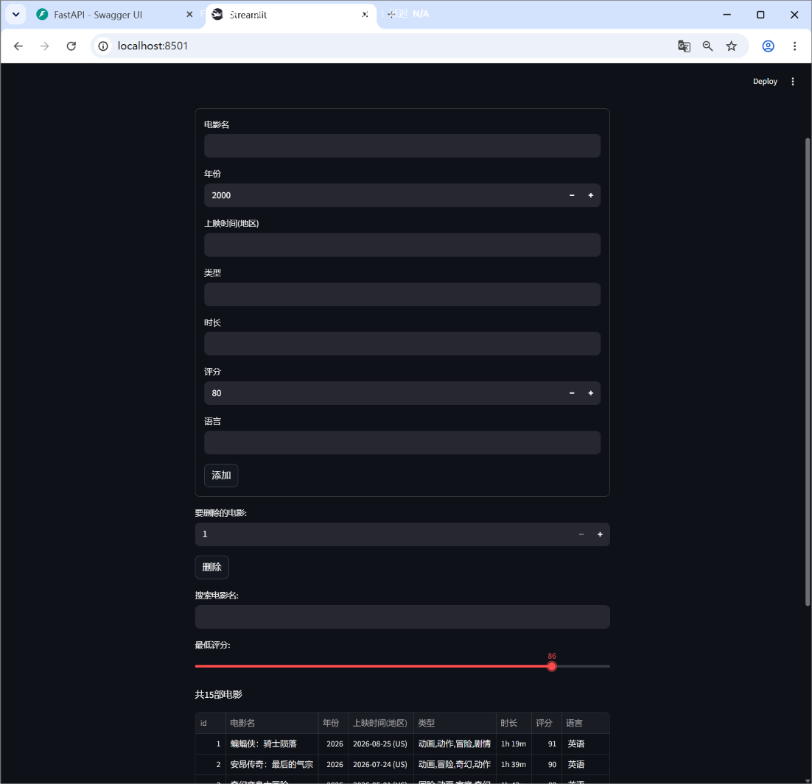
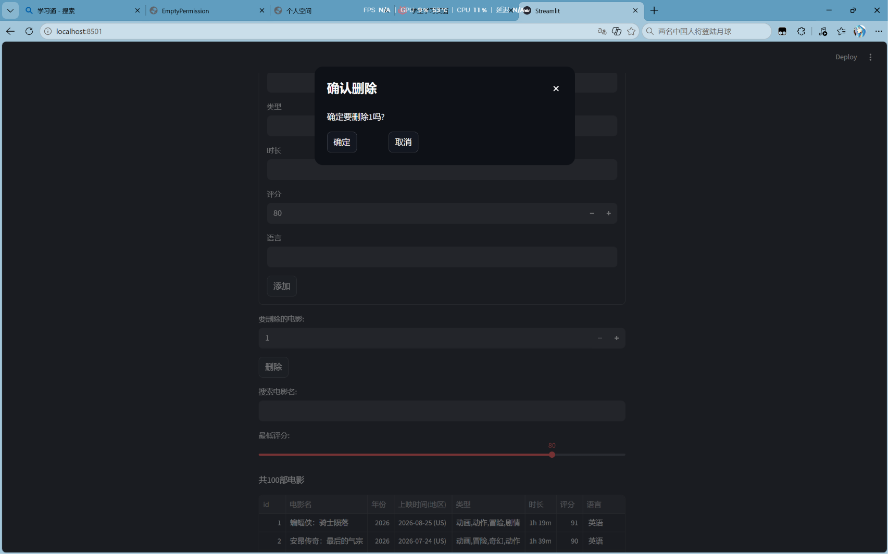

# 电影数据管理系统

一个前后端分离的小项目：爬取电影数据，存入数据库，通过 API 提供增删查功能，并用网页界面展示。

## 技术栈
- 爬虫：Python（requests + lxml/XPath），数据来自 TMDB 高分电影榜
- 数据库：SQLite
- 后端：FastAPI
- 前端：Streamlit

## 功能
- 按电影名搜索、按最低评分筛选
- 在页面上添加电影（表单）
- 在页面上删除电影（弹窗确认）

## 项目结构
c.py          爬虫（抓取 TMDB 榜单，输出 csv2.csv）
csv2.csv      爬取到的电影数据
to_db.py      把 CSV 导入 SQLite（只需运行一次）
main.py       FastAPI 后端
app.py        Streamlit 前端
movies.db     SQLite 数据库

## 运行方法
1. 安装依赖：`pip install -r requirements.txt`
2. 首次运行：`python to_db.py`（生成 movies.db，**之后不要重复运行，会覆盖数据**）
3. 启动后端：`python main.py`（地址 http://127.0.0.1:8000 ，接口文档见 /docs）
4. 另开一个终端启动前端：`streamlit run app.py`

## 接口
| 方法 | 路径 | 说明 |
|---|---|---|
| GET | /movies?sj=关键词&pf=最低评分 | 搜索和筛选 |
| POST | /movies | 添加电影 |
| DELETE | /movies/{id} | 删除电影 |

## 截图

